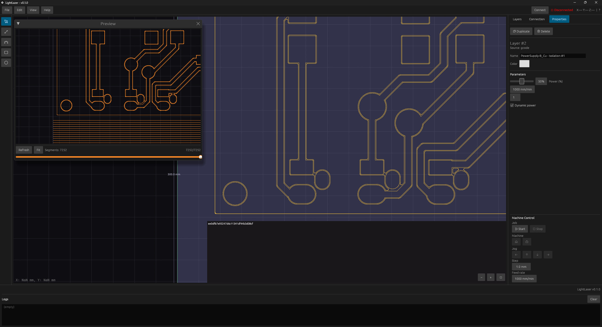

# LightLaser




LightLaser is a desktop laser engraving and cutting control application written in Rust. It provides a graphical interface for composing jobs from images, SVG files, G-code files, Gerber files, and vector drawing tools, then streaming the resulting G-code to a GRBL-based laser controller over a serial port.

## Features

- Cross-platform GUI built with `eframe` / `egui`.
- GRBL communication over serial with a streaming sender that respects the controller RX buffer.
- Live status polling (machine position, work position, feed, spindle).
- Job controls: start, pause, resume, stop, home, unlock.
- Jog controls with configurable step and feed rate.
- Layer system:
    - Image layers with raster engraving parameters (power, feed rate, passes, pixels per millimetre, threshold, dither, invert).
    - SVG layers, engraved either as a raster or traced into lines, imported at the size the file declares: a `63.9826mm` by `59.9948mm` board becomes a layer of exactly that size, and the drawing is never stretched on the canvas.
    - G-code and Gerber layers as imported sources.
    - Vector layers drawn with line, curve, rectangle, and circle tools.
- Layer visibility, enable/disable, reordering, renaming, colour editing, duplication, and deletion.
- Project save/load in TOML format with version checking.
- G-code export of the full job to a `.nc` file.
- Undo/redo history for project edits.
- Configurable work area, grid, axes, and grid step.
- Settings window with interface scale, console font size, a custom font file, the UI language, and the SVG import size profile.
- Grid snapping is always enabled, at a fixed 1 mm step; holding `Shift` while dragging an object moves it freely.
- Internationalization with English and Russian locales.
- Logging to the console and to an in-app console window.

## Requirements

- Rust toolchain with edition 2024 support.
- A GRBL-compatible laser controller connected via a serial port (optional for offline job preparation and export).

## Building

```
cargo build --release
```

The build script copies locale files from `locales/` into the target output directory so they are available at runtime next to the executable.

## Running

```
cargo run --release
```

## Usage Overview

1. Open the application. The main window contains a tool panel on the left, the canvas in the center, the layer/parameters panel on the right, and a status strip at the bottom. The log is shown in a separate console window (`View > Console`).
2. Add content:
    - `File > Import > Add image` to create image layers.
    - `File > Import > Add SVG` to import SVG files at the size their own `width` and `height` declare.
    - `File > Import > Import SCG (PCB)` to import a board export whose numbers carry no unit: they are read as millimetres, which is what PCB tools mean by them. The `SVG import size` setting in `Settings > Design` picks the profile that drag and drop uses.
    - `File > Import > Add G-code` to import existing G-code.
    - `File > Import > Add Gerber` to import a Gerber file.
    - Use the drawing tools to create vector shapes directly on the canvas.
    - Files can also be dragged onto the window; the extension selects the importer.
3. Select a layer in the right panel and adjust its parameters (position, power, feed rate, passes, and image-specific options where applicable). Hovering a control shows a tooltip describing what it does.
4. Toggle layer visibility and enabled state as needed. Only enabled layers are included in jobs and exports.
5. Connect to the machine via the connection dialog, selecting the serial port and baud rate.
6. Use `Start` to stream the job to the controller, or `File > Export G-code` to save it to a file.
7. Save the project with `File > Save project` (TOML format).

## Project Files

Projects are stored as TOML and include:

- Project version and name.
- Machine configuration (port, baud rate, work area, jog step, jog feed, and the number of times the whole job is run).
- Layers with source type, color, visibility, enabled state, parameters, bounds, vector shapes, and offset.

## Configuration

Application settings are stored in `config/app_config.toml` next to the executable, and are written when the settings window is closed and when the application exits. Settings include window size, locale, theme, interface scale, console font size, custom font file, grid step, the SVG import size profile, and visibility toggles for grid, axes, and work area.

## Locales

Locale files are TOML dictionaries located in `locales/`. The following locales are supported:

- `en.toml` (English)
- `ru.toml` (Russian)

## Keyboard Shortcuts

- `Ctrl+Z` — undo
- `Ctrl+Shift+Z` or `Ctrl+Y` — redo
- `Ctrl+S` — save project
- `Ctrl+Shift+S` — save project as
- `Ctrl+D` — duplicate selection
- `Delete` / `Backspace` — delete selection
- `Escape` — cancel current tool action
- `Enter` — finish current tool action
- `Shift` (held while dragging an object) — move without grid snapping

## Known Limitations

- The theme selector in the settings window is stored in the configuration file but is not applied to the interface; the application uses the default egui visuals.
- The machine configuration stores a serial port and baud rate, but not laser mode, soft limits, or homing settings.

## Project Structure

- `src/comm` — serial connection, GRBL protocol, status parsing, and job streamer.
- `src/core` — geometry, bounding boxes, project and layer model, image rasterization and engraving, Gerber import, G-code parsing and generation, vector paths, and drawing tools.
- `src/ui` — application state, panels, canvas rendering and input, dialogs, history, selection, and widgets.
- `src/i18n_backend.rs` — custom locale backend that loads TOML translation files.
- `src/logger.rs` — logger that writes to both console and an in-memory buffer for the UI.
- `src/dirs.rs` — resolution of the configuration directory.
- `locales/` — translation files.
- `build.rs` — copies locale files to the output directory.

## License

Not specified.
