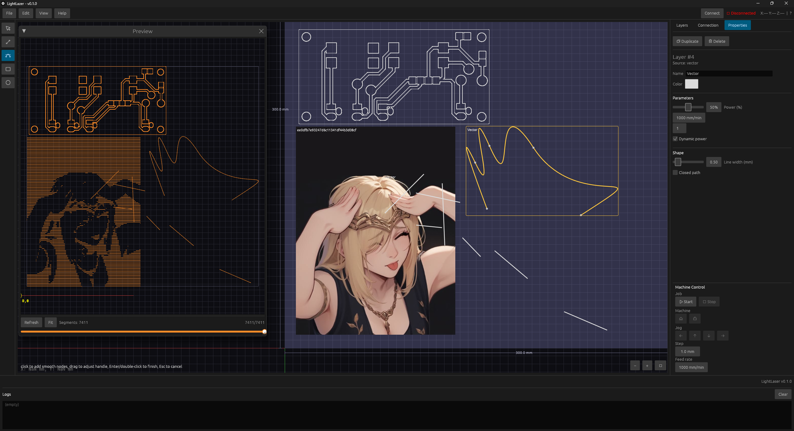

# LightLaser




LightLaser is a desktop laser engraving and cutting control application written in Rust. It
composes jobs from images, SVG files, G-code and Gerber files, and vector shapes drawn on the
canvas, then streams the resulting G-code to a GRBL-based laser controller over a serial port.

## Features

**Editor**

- Canvas-based editor with zoom, pan, grid, axes, and a work-area outline.
- Layers: image, SVG, G-code, Gerber, and vector. Every layer has a colour, a name, a
  visibility flag (canvas) and an enabled flag (jobs and exports).
- Vector drawing tools: line, curve, rectangle, circle, plus node and handle editing.
- Move, rubber-band select, mirror, round-to-step, copy, paste, duplicate, delete.
- Undo and redo for canvas edits and for layer position edits (see limitations for
  exceptions).
- Drag and drop files onto the window; the extension selects the importer.

**Engraving**

- Raster engraving with pixels per millimetre, threshold, invert, power, feed rate, and pass
  count.
- SVG import at the size the file declares, engraved either as a raster or traced into
  lines.
- Gerber import with aperture handling, regions, arcs, and polygon union, chained into
  continuous tool paths.
- Imported G-code is re-emitted at the layer's position with the layer's power and feed.
- Live preview of the job geometry, with a progress slider, and a G-code viewer.

**Machine**

- GRBL serial connection with port and baud rate selection.
- Character-counting streaming that respects the controller RX buffer.
- Start, pause, resume, stop, home, unlock.
- Jog crosshair with configurable step and feed rate.
- Live machine state and machine position from GRBL status reports.
- G-code export to a `.nc` file.

**Application**

- English and Russian locales.
- Interface scale, console font size, optional custom UI font.
- Logging to stderr and to an in-app console window.
- Project save/load in TOML.

## Requirements

- A Rust toolchain with edition 2024 support (Rust 1.85 or newer).
- A GRBL-compatible laser controller on a serial port, optional for offline preparation and
  export.

## Building

```
cargo build --release
```

The build script copies the TOML files from `locales/` into `target/<profile>/locales`, so
they sit next to the executable at runtime.

## Testing

```
cargo test
```

The suite currently covers G-code line parsing and SVG size parsing (13 tests pass, 1 ignored
performance benchmark). `cargo check --all-targets` also reports the current list of dead-code
warnings; see [REFACTOR_REPORT.md](REFACTOR_REPORT.md).

## Running

```
cargo run --release
```

## Documentation

- [PROJECT_MAP.md](PROJECT_MAP.md) — module map, runtime topology, data model, and where to
  change what.
- [REFACTOR_REPORT.md](REFACTOR_REPORT.md) — structural findings, known correctness issues,
  and a staged cleanup plan.

## Using the application

1. The main window has a tool rail on the left, the canvas in the centre, the layer and
   property panel on the right (with machine controls at its bottom), a menu bar on top, and
   a status strip at the bottom. `View > Console` opens the log window.
2. Add content:
   - `File > Import > Add image` creates an image layer, imported 100 mm wide and scaled by
     aspect ratio.
   - `File > Import > Add SVG` imports at the size declared in the file's own attributes.
   - `File > Import > Import SCG (PCB)` reads unitless numbers as millimetres, which is what
     PCB exports mean. The `SVG import size` setting selects the profile used by drag and
     drop.
   - `File > Import > Add G-code` and `Add Gerber` add imported sources.
   - Draw with the tools on the left rail: line, rectangle, and circle finish on the second
     click; the curve tool adds nodes and finishes with `Enter`, a double-click, or a
     right-click. `Escape` cancels the current shape.
   - Files can also be dropped onto the window.
3. Select a layer in the right panel and adjust its parameters. Hover a control to see what
   it does.
4. Use the visibility checkbox to hide a layer on the canvas and the enabled checkbox to
   include or exclude it from jobs and exports.
5. Connect through the connection dialog, choosing the serial port and baud rate.
6. Press `Start` to stream the job, or `File > Export G-code` to save it to a file.
7. Save the project with `File > Save project` (TOML).

## Layer types

| Source | Geometry comes from | Relevant parameters |
| --- | --- | --- |
| Image | Rasterized at the layer's px/mm and thresholded | power, feed, passes, px/mm, threshold, invert |
| SVG (raster) | Rendered into the layer box, then engraved as a raster | same as image |
| SVG (lines) | Rasterized, thinned, traced, simplified | power, feed, passes, px/mm |
| G-code | Parsed into XY moves | power, feed, passes, mirror |
| Gerber | Parsed and flattened into polylines | power, feed, passes |
| Vector | Flattened from the layer's node paths | power, feed, passes, closed (line width affects bounds only) |

## Project files

Projects are TOML documents containing:

- The project version (currently `1`) and name.
- Machine configuration: port, baud rate, work area, jog step, jog feed, and how many times
  the whole job runs.
- Layers with source type, colour, visibility, enabled state, parameters, bounds, vector
  shapes, offset, and mirror settings.

Loading a project with a different version logs a warning and continues.

## Configuration

Application settings live in `config/app_config.toml` next to the executable. They are
written when the settings window is closed and when the application exits. Settings include
window size, locale, theme, grid step, grid/axes/work-area visibility, interface scale,
console font size, a custom UI font file, and the SVG import size profile.

## Locales

Translations are flat TOML dictionaries in `locales/`:

- `en.toml` — English
- `ru.toml` — Russian

Both files currently hold the same 138 keys. At runtime they are read from `<exe>/locales`.

## Keyboard and mouse

| Input | Action |
| --- | --- |
| `Ctrl+Z` | Undo |
| `Ctrl+Shift+Z` or `Ctrl+Y` | Redo |
| `Ctrl+S` | Save project |
| `Ctrl+Shift+S` | Save project as |
| `Ctrl+C` / `Ctrl+V` | Copy / paste selection |
| `Ctrl+D` | Duplicate selection |
| `Delete` / `Backspace` | Delete selection |
| `Escape` | Cancel the current tool action |
| `Enter` | Finish the current tool action |
| Middle-drag | Pan the canvas |
| Wheel | Zoom at the pointer |
| Drag on empty canvas | Rubber-band selection |
| `Shift` while dragging | Move without grid snapping |
| Right-click canvas | Context menu (preview, G-code, copy, delete, mirror, round) |

On macOS, `Ctrl` means `Cmd` where the platform uses it.

## Known limitations

- The theme selector is stored but not applied; the interface uses the default egui visuals.
- The window size is saved but not restored; the window opens at 1200 × 720.
- `Dither` is stored, serialised, and shown in the UI, but the rasterizer ignores it.
- Undo covers canvas edits and layer position edits. Parameter changes (power, feed, name,
  colour), deleting or reordering layers in the layer list, and toggling visibility/enabled
  are not undoable.
- A hidden but enabled layer is not drawn on the canvas or in the preview, yet it is included
  in jobs and exports.
- Imported G-code is re-emitted as `G0`/`G1` moves with the layer's power and feed: arcs
  become straight lines, relative coordinates are not supported, and `S`, `M3`/`M4`, and `Z`
  from the source are dropped.
- Work position, feed, and spindle are parsed from status reports but only the machine
  position is shown in the interface.
- The machine configuration does not store laser mode, soft limits, or homing settings.
- The work area comes from the controller (`$130`/`$131`) or defaults to 300 × 300 mm; it is
  not editable in the settings window.
- `config/` next to the executable must be writable; an installation in a protected
  directory cannot save settings or projects.
- Grid snapping is always on at a fixed 1 mm step; `Shift` disables it while dragging. The
  grid step setting only affects how the grid is drawn.

## Project structure

- `src/comm` — serial transport, GRBL connection, status parsing, streaming thread.
- `src/core` — document model, geometry, raster/SVG/Gerber import, engraving, G-code
  generation, vector paths, and drawing tools.
- `src/ui` — application state, panels, canvas, dialogs, history, selection, widgets.
- `src/i18n_backend.rs` — TOML locale backend.
- `src/logger.rs` — stderr plus in-memory log buffer.
- `src/dirs.rs` — config directory resolution.
- `locales/` — translation files.
- `build.rs` — copies locales into the target directory.

See [PROJECT_MAP.md](PROJECT_MAP.md) for the full map, including entry points and the job and
canvas pipelines.

## License

Not specified.
